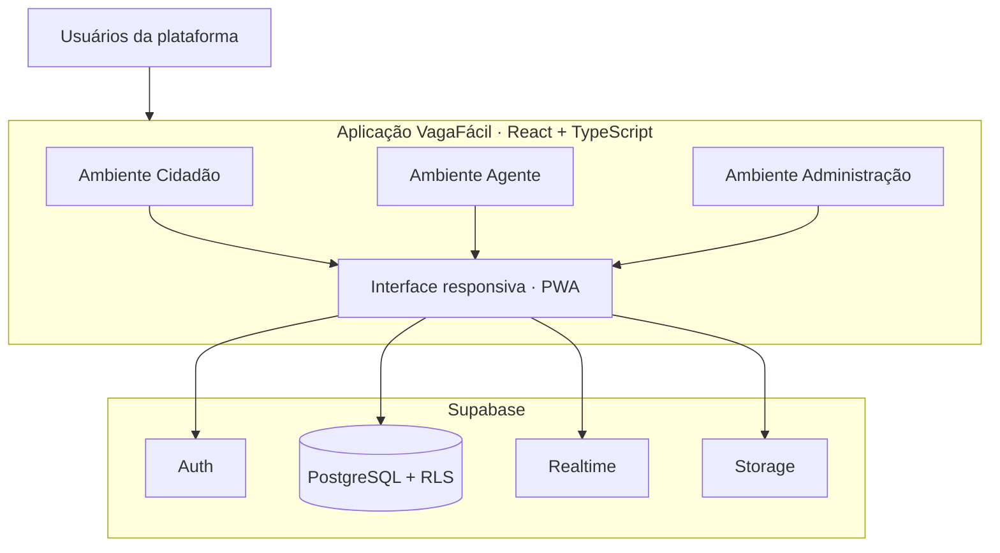

<div align="center">

# VagaFácil
### Estacionar ficou mais fácil.

**Uma plataforma de estacionamento rotativo municipal que conecta cidadãos, agentes de trânsito e gestores em uma experiência digital integrada.**

[](https://github.com/DevKove/VagaFacil/actions/workflows/validate.yml)


[Visão geral](#-visão-geral) · [Ambientes](#-três-ambientes-integrados) · [Arquitetura](#-arquitetura) · [Instalação](#-instalação) · [Banco de dados](#-banco-de-dados) · [Segurança](#-segurança)

</div>

---

## 🚦 Visão geral

O **VagaFácil** está sendo desenvolvido para modernizar a operação do estacionamento rotativo municipal. A proposta é reunir em uma única plataforma os recursos usados por quem estaciona, por quem realiza a fiscalização em campo e pela equipe responsável pela gestão do serviço.

O projeto utiliza uma aplicação web responsiva, com estrutura preparada para instalação como **PWA**, e uma infraestrutura centralizada no **Supabase**.

> **Princípio operacional:** o sistema registra e sinaliza situações de estacionamento. Um alerta de vencimento não representa, por si só, uma infração ou aplicação automática de multa. A fiscalização depende da verificação e dos procedimentos previstos pelo município.

## ✨ Três ambientes integrados

| 🚗 Cidadão | 🦺 Agente de trânsito | 🏛️ Administração |
|---|---|---|
| Área destinada ao motorista. | Área operacional de fiscalização. | Gestão e acompanhamento municipal. |
| Cadastro e consulta de veículos. | Alertas e acompanhamento de sessões. | Visão geral da operação. |
| Registro e histórico de estacionamento. | Consulta de informações para verificação em campo. | Gestão de zonas, vagas, regras e usuários. |
| Consulta de notificações. | Registro de ocorrências e evidências. | Indicadores e relatórios gerenciais. |

Os módulos acima representam o escopo funcional planejado. Consulte a seção [estado atual](#-estado-atual-do-projeto) para distinguir o que já existe no código do que ainda está em implementação.

## 🧭 Experiência da plataforma

A interface inicial apresenta uma central de controle com:

- Indicadores de sessões e situações que exigem atenção.
- Visão gráfica da movimentação.
- Distribuição de sessões por situação.
- Lista pesquisável de estacionamentos recentes.
- Navegação entre os três ambientes de trabalho.
- Layout adaptável para computadores, tablets e celulares.

**Atenção:** os números e registros apresentados na interface inicial são demonstrativos. Eles não representam dados reais de uma cidade nem estão conectados a consultas operacionais neste estágio.

## 🏗️ Arquitetura

A aplicação foi organizada para manter a interface separada dos serviços de dados e concentrar autenticação, persistência e controle de acesso no backend.



### Tecnologias

| Tecnologia | Responsabilidade |
|---|---|
| [React](https://react.dev/) | Construção da interface por componentes. |
| [TypeScript](https://www.typescriptlang.org/) | Tipagem estática e manutenção segura. |
| [Vite](https://vite.dev/) | Desenvolvimento e empacotamento da aplicação. |
| [Supabase](https://supabase.com/) | Autenticação, PostgreSQL, políticas RLS, Realtime e Storage. |
| [Lucide](https://lucide.dev/) | Ícones da interface. |
| PWA / Service Worker | Instalação e cache da estrutura básica da aplicação. |

### Organização do repositório

```text
VagaFacil/
├── .github/
│   └── workflows/
│       └── validate.yml       # Validação automatizada
├── public/
│   ├── favicon.svg
│   ├── manifest.webmanifest   # Metadados da PWA
│   ├── readme-cover.svg       # Ilustração deste README
│   └── sw.js                  # Service Worker
├── src/
│   ├── lib/
│   │   └── supabase.ts        # Cliente Supabase
│   ├── App.tsx                # Interface principal
│   ├── main.tsx               # Inicialização
│   ├── styles.css             # Estilos responsivos
│   └── vite-env.d.ts
├── supabase/
│   └── migrations/            # Estrutura inicial do banco
├── .env.example
├── index.html
├── package.json
├── tsconfig.json
└── vite.config.ts
```

## 🚀 Instalação

### Pré-requisitos

- Node.js 22 ou superior.
- npm.
- Projeto Supabase para habilitar os serviços de backend.

### 1. Obtenha o código

```bash
git clone https://github.com/DevKove/VagaFacil.git
cd VagaFacil
```

### 2. Instale as dependências

```bash
npm install
```

### 3. Configure o ambiente

Crie seu arquivo local a partir do modelo:

```bash
cp .env.example .env.local
```

No Windows PowerShell, se necessário:

```powershell
Copy-Item .env.example .env.local
```

Preencha o arquivo `.env.local`:

```env
VITE_SUPABASE_URL=https://SEU_PROJETO.supabase.co
VITE_SUPABASE_PUBLISHABLE_KEY=SUA_CHAVE_PUBLICA
```

Use somente a chave publicável/anon apropriada para o cliente. **Nunca coloque a chave `service_role`, segredos administrativos ou senhas no frontend, no Git ou em variáveis `VITE_*`.**

### 4. Inicie o ambiente local

```bash
npm run dev
```

O Vite exibirá no terminal o endereço local para abrir no navegador.

### 5. Gere a versão de produção

```bash
npm run build
npm run preview
```

## 🗄️ Banco de dados

A estrutura inicial do banco está em:

`supabase/migrations/202611100001_initial_schema.sql`

Ela define a base para:

- Perfis e papéis de acesso.
- Veículos.
- Zonas e vagas de estacionamento.
- Regras e feriados.
- Sessões de estacionamento.
- Alertas e fiscalizações.
- Fotografias/evidências.
- Notificações e registros de auditoria.

### Aplicação da migration

1. Crie ou selecione o projeto Supabase de destino.
2. Abra o SQL Editor no painel do projeto.
3. Revise a migration e os parâmetros regulamentares.
4. Execute o SQL em ambiente de desenvolvimento/homologação.
5. Valide as tabelas, índices, permissões e políticas RLS antes de disponibilizar qualquer fluxo.

A migration é uma **estrutura inicial**, não uma implantação completa do backend. Os fluxos transacionais de início e encerramento de sessões, cálculo confiável de expiração, geração de alertas e rotinas operacionais no servidor ainda precisam ser implementados e testados.

## 🔐 Segurança e privacidade

Segurança deve ser aplicada no banco e no servidor, não apenas escondendo botões na interface.

- Políticas de **Row Level Security (RLS)** nas tabelas expostas.
- Papéis de usuário controlados pelo backend.
- Chaves administrativas mantidas exclusivamente em ambiente seguro no servidor.
- Validação de propriedade do veículo e das operações.
- Auditoria das ações administrativas e operacionais.
- Dados pessoais limitados ao necessário para a finalidade do serviço.

**Antes de produção:** revisar todas as políticas RLS, testar tentativas de acesso entre usuários e papéis, implementar operações privilegiadas por funções seguras no servidor e definir retenção, acesso e descarte de dados conforme a legislação aplicável e as normas municipais.

## 📱 PWA e dispositivos

A aplicação contém manifesto e Service Worker iniciais. Isso prepara a instalação e o cache da estrutura básica, mas não equivale a uma experiência offline completa.

A operação offline de registros, pagamentos, sincronização posterior e fiscalização não deve ser considerada disponível até que esses fluxos tenham sido projetados e testados especificamente.

## 🧪 Qualidade e validação

O workflow do GitHub Actions executa:

```bash
npm install
npm run build
npm run lint
```

A aprovação desse workflow valida compilação e lint. Ela **não substitui** testes de integração com Supabase, testes de autorização/RLS, testes de navegador, auditoria de segurança ou homologação operacional.

## 📌 Estado atual do projeto

**Etapa: fundação inicial em desenvolvimento.**

| Componente | Situação |
|---|---|
| Estrutura React, TypeScript e Vite | ✅ Criada |
| Identidade visual e dashboard inicial | ✅ Criados |
| Navegação entre ambientes | ✅ Estrutura inicial |
| Configuração do cliente Supabase | ✅ Criada; credenciais pendentes |
| Migration inicial e políticas RLS | 🟡 Criadas; requerem revisão e testes |
| Manifesto e Service Worker | 🟡 Estrutura inicial |
| Autenticação e gestão de contas | ⏳ A implementar |
| Operações reais de estacionamento | ⏳ A implementar |
| Fiscalização e alertas em tempo real | ⏳ A implementar |
| Mapa, relatórios e notificações reais | ⏳ A implementar |
| Testes completos e homologação | ⏳ Pendentes |
| Implantação em produção | ⏳ Não realizada |

Não utilize esta versão para operação real, cobrança, autuação ou tomada de decisão administrativa até a conclusão da implementação, dos testes e da homologação pelo município.

## 🗺️ Próximas etapas

1. Configurar o projeto Supabase e aplicar a migration revisada.
2. Implementar autenticação, cadastro e recuperação de acesso.
3. Construir os fluxos reais do cidadão e o controle de sessões no servidor.
4. Implementar alertas, fiscalização, evidências e mapa operacional.
5. Concluir a administração de zonas, vagas, regras, usuários e relatórios.
6. Automatizar testes funcionais, de segurança e responsividade.
7. Realizar homologação e preparar a publicação.

## 🤝 Contribuição

1. Crie uma branch para sua alteração.
2. Mantenha tipagem estrita e componentes coesos.
3. Não envie arquivos `.env`, credenciais ou dados pessoais.
4. Execute `npm run build` e `npm run lint`.
5. Abra um Pull Request com contexto, alterações e evidências de teste.

## 📄 Licença

A licença do projeto ainda não foi definida. Até que um arquivo de licença seja incluído no repositório, não presuma autorização para redistribuir ou utilizar o código fora das permissões aplicáveis.

---

<div align="center">

**VagaFácil** · Tecnologia a serviço da mobilidade urbana.

Desenvolvido para apoiar uma gestão de estacionamento rotativo mais organizada, transparente e eficiente.

</div>
