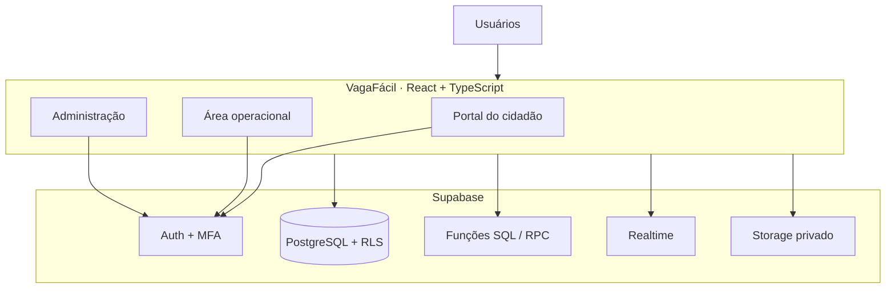

<div align="center">

# VagaFácil
### Estacionar ficou mais fácil.

**Plataforma web de estacionamento rotativo gratuito, com portal do cidadão, operação de fiscalização e administração municipal.**

[](https://github.com/DevKove/VagaFacil/actions/workflows/validate.yml)


[Aplicação](https://devkove.github.io/VagaFacil/) · [Repositório](https://github.com/DevKove/VagaFacil) · [Validação](https://github.com/DevKove/VagaFacil/actions/workflows/validate.yml) · [Implantação](https://github.com/DevKove/VagaFacil/actions/workflows/deploy.yml)

</div>

---

## Visão geral

O **VagaFácil** é um sistema de estacionamento rotativo municipal gratuito. A aplicação reúne os serviços do motorista, as ferramentas de fiscalização e os recursos de gestão em uma plataforma web responsiva, conectada ao Supabase.

O projeto está em desenvolvimento contínuo. Algumas rotinas já estão integradas ao banco de dados, enquanto outros recursos ainda exigem implementação, testes e homologação municipal. Este README descreve o estado do código, sem tratar funcionalidades planejadas como concluídas.

> **Importante:** o sistema é uma ferramenta de apoio ao controle do estacionamento. O vencimento de uma sessão ou a geração de um alerta não constitui, isoladamente, autuação ou aplicação automática de penalidade. A fiscalização deve seguir a legislação e os procedimentos do município.

## Ambientes e funcionalidades

### 🚗 Portal do cidadão

- Cadastro de conta por e-mail e senha.
- Recuperação e atualização de senha.
- Cadastro e remoção de veículos vinculados à conta.
- Registro de chegada em vaga, com seleção opcional da vaga cadastrada.
- Cronômetro de permanência e consulta de sessões ativas.
- Encerramento de estacionamento pelo próprio usuário.
- Histórico de registros e notificações.
- Atualização dos dados de estacionamento por Supabase Realtime.
- Categorias convencional, idoso e pessoa com deficiência, sujeitas à credencial válida e às regras legais aplicáveis.

### 🦺 Área do agente de trânsito

- Painel operacional com sessões e situações que exigem atenção.
- Consulta e pesquisa de estacionamentos.
- Fila de alertas e possibilidade de assumir atendimento.
- Registro do resultado da verificação em campo.
- Observações e envio de evidências fotográficas.
- Histórico de fiscalizações.

### 🏛️ Área administrativa

- Painel de indicadores operacionais.
- Cadastro e manutenção de zonas e vagas.
- Configuração de regras e tempos de permanência.
- Gestão de contas, perfis e ativação de usuários.
- Consulta de sessões e alertas.
- Mapa com as coordenadas cadastradas para as vagas.
- Relatório de estacionamentos com exportação CSV.
- Trilha de auditoria das operações registradas pelo banco.

A disponibilidade de cada operação depende das permissões da conta, das políticas RLS e da configuração do projeto Supabase.

## Regras de estacionamento

O portal do cidadão apresenta os parâmetros iniciais abaixo:

| Regra | Período |
|---|---|
| Segunda a sexta-feira | 9h às 18h |
| Sábado | 9h às 13h |
| Uso convencional | Até 1 hora |
| Categorias especiais | Até 2 horas, mediante credencial válida |

Os parâmetros são configuráveis pelas regras armazenadas no banco. Antes de utilizar o sistema em uma cidade, a administração municipal deve conferir e homologar horários, limites, tolerâncias, feriados, sinalização e demais condições previstas na regulamentação local.

## Segurança

- Autenticação gerenciada pelo Supabase Auth.
- Perfis e papéis consultados no banco de dados.
- Verificação de conta ativa e autorização de acesso por ambiente.
- Autenticação multifator TOTP para perfis operacionais e administrativos.
- Políticas Row Level Security (RLS) nas tabelas expostas.
- Operações de início e encerramento de estacionamento executadas por funções SQL (RPC).
- Evidências armazenadas em bucket privado, com acesso por links assinados.
- Registro de eventos de auditoria no banco.
- Chave publicável no frontend; credenciais administrativas não devem ser expostas.

O fluxo MFA utiliza o emissor **VagaFácil** para novos cadastros de autenticador. Uma entrada TOTP já cadastrada em um aplicativo autenticador não tem seu emissor alterado automaticamente.

## Arquitetura e tecnologias

| Tecnologia | Uso |
|---|---|
| React 19 | Interface e componentes |
| TypeScript 5 | Tipagem estática |
| Vite 6 | Desenvolvimento e build |
| Supabase Auth | Autenticação e MFA |
| Supabase PostgreSQL | Persistência e regras de acesso |
| Supabase Realtime | Atualização de sessões |
| Supabase Storage | Armazenamento privado de evidências |
| Lucide React | Ícones |
| PWA / Service Worker | Manifesto e cache da aplicação |
| GitHub Actions | Validação e publicação |



## Estrutura do projeto

```text
VagaFacil/
├── .github/
│   └── workflows/
│       ├── validate.yml
│       └── deploy.yml
├── public/
│   ├── IMG/
│   │   └── logo-vagafacil.svg
│   ├── favicon.svg
│   ├── manifest.webmanifest
│   ├── readme-cover.svg
│   └── sw.js
├── src/
│   ├── features/
│   │   ├── citizen/
│   │   │   └── CitizenWorkspace.tsx
│   │   └── operations/
│   │       └── OperationsWorkspace.tsx
│   ├── lib/
│   │   └── supabase.ts
│   ├── App.tsx
│   ├── main.tsx
│   └── styles.css
├── supabase/
│   └── migrations/
├── .env.example
├── index.html
├── package.json
├── tsconfig.json
└── vite.config.ts
```

## Pré-requisitos

- Node.js 22 ou superior.
- npm.
- Projeto Supabase configurado.

## Instalação local

### 1. Clonar o repositório

```bash
git clone https://github.com/DevKove/VagaFacil.git
cd VagaFacil
```

### 2. Instalar dependências

```bash
npm install
```

### 3. Configurar variáveis de ambiente

Copie o modelo:

```bash
cp .env.example .env.local
```

No Windows PowerShell:

```powershell
Copy-Item .env.example .env.local
```

Configure o arquivo `.env.local`:

```env
VITE_SUPABASE_URL=https://SEU_PROJETO.supabase.co
VITE_SUPABASE_PUBLISHABLE_KEY=SUA_CHAVE_PUBLICA
```

Utilize a chave publicável (ou anon, em projetos legados) apropriada para o cliente. **Nunca** coloque `service_role`, tokens privados, senhas ou segredos em variáveis `VITE_*`, no frontend ou no repositório.

### 4. Executar em desenvolvimento

```bash
npm run dev
```

O Vite informará o endereço local no terminal.

### 5. Validar e gerar build

```bash
npm run lint
npm run build
npm run preview
```

## Banco de dados e migrations

As migrations versionadas ficam em `supabase/migrations/` e devem ser aplicadas em ordem cronológica:

| Migration | Finalidade |
|---|---|
| `202611100001_initial_schema.sql` | Estrutura inicial, tabelas e políticas-base |
| `202611100002_foreign_key_indexes.sql` | Índices para chaves estrangeiras |
| `202611100003_parking_session_rpcs.sql` | Funções SQL para iniciar e encerrar sessões |
| `202611100004_special_parking_categories.sql` | Categorias especiais e regras relacionadas |
| `202611100005_management_permissions.sql` | Permissões de gestão |
| `202611100006_operations_evidence_audit.sql` | Evidências operacionais e auditoria |
| `202611100007_audit_log_read_only.sql` | Restrição de escrita direta na trilha de auditoria |

### Aplicação

1. Crie ou selecione o projeto Supabase de destino.
2. Revise os arquivos SQL da pasta `supabase/migrations/`.
3. Aplique as migrations em ordem, preferencialmente com Supabase CLI e controle de versão do banco.
4. Configure autenticação, URLs de redirecionamento e políticas de confirmação de e-mail no painel Supabase.
5. Confira buckets, políticas de Storage, funções SQL e políticas RLS.
6. Crie e valide as contas administrativas e operacionais por um procedimento seguro.
7. Execute testes com contas de cada perfil antes da homologação.

Não execute migrations isoladas fora de ordem em um banco já utilizado. Faça backup e valide as alterações primeiro em ambiente de desenvolvimento ou homologação.

## Autenticação e primeiro acesso

- O cadastro público disponível na interface é destinado ao cidadão.
- Contas de agente, supervisor e administrador devem ser provisionadas e autorizadas pela administração, com papéis atribuídos no backend.
- Contas operacionais e administrativas passam pela verificação TOTP antes de acessar seus ambientes.
- A criação de uma conta no Auth, por si só, não concede permissão administrativa.

## PWA e publicação

A aplicação possui manifesto e Service Worker e está configurada para publicação no GitHub Pages em:

**https://devkove.github.io/VagaFacil/**

O caminho-base do Vite está definido como `/VagaFacil/`. Para desenvolvimento local, use `npm run dev`; para validar a versão compilada, use `npm run preview`.

A presença do manifesto e do Service Worker não significa que todas as operações estejam disponíveis offline. Registros, autenticação, sincronização e fiscalização dependem de conexão e dos serviços configurados.

## CI/CD

O GitHub Actions possui dois fluxos:

- **Validate VagaFácil:** instala dependências e executa `npm run build` e `npm run lint`.
- **Deploy VagaFácil to GitHub Pages:** compila e publica a aplicação no GitHub Pages após os eventos configurados no workflow.

A aprovação da validação confirma compilação e lint. Ela não substitui testes de integração, testes de autorização/RLS, testes de navegador, auditoria de segurança ou homologação funcional.

Acompanhe os resultados em [GitHub Actions](https://github.com/DevKove/VagaFacil/actions).

## Estado do projeto

O sistema já possui fluxos conectados ao Supabase para cidadão, operação e administração, incluindo autenticação, MFA para perfis operacionais/administrativos, gestão de veículos, sessões, zonas, vagas, alertas, fiscalizações, evidências, auditoria e exportação CSV.

Ainda são necessários testes integrados e validação operacional abrangente. Pontos que não devem ser considerados concluídos sem implementação e homologação específicas:

- Cobertura completa de testes automatizados e jornadas E2E para todos os perfis.
- Auditoria independente das políticas RLS, funções SQL e fluxos de autorização.
- Validação de regras municipais, feriados, tolerâncias e exceções.
- Homologação de instalação PWA e comportamento em diferentes dispositivos.
- Verificação de recuperação de falhas durante operações com múltiplas etapas, como registro e upload de evidências.
- Testes de carga, monitoramento e procedimentos de backup e recuperação.

**Não utilize o sistema como única fonte para autuação, cobrança ou decisão administrativa até que a implantação esteja formalmente homologada pelo município.**

## Contribuição

1. Crie uma branch para sua alteração.
2. Mantenha tipagem estrita e componentes coesos.
3. Não envie arquivos `.env`, credenciais ou dados pessoais.
4. Execute `npm run lint` e `npm run build`.
5. Descreva no Pull Request o objetivo, as alterações e as evidências de teste.

## Licença

Ainda não há um arquivo de licença no repositório. Até que uma licença seja definida e publicada, não presuma autorização para redistribuir ou utilizar o código além das permissões aplicáveis.

---

<div align="center">

**VagaFácil** · Tecnologia a serviço da mobilidade urbana.

Mobilidade mais simples, fiscalização mais organizada e gestão mais transparente.

</div>
