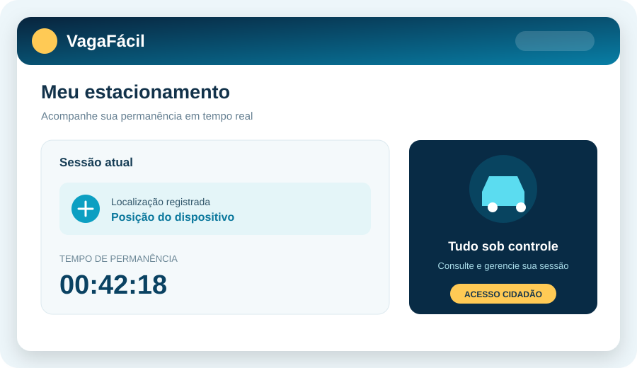
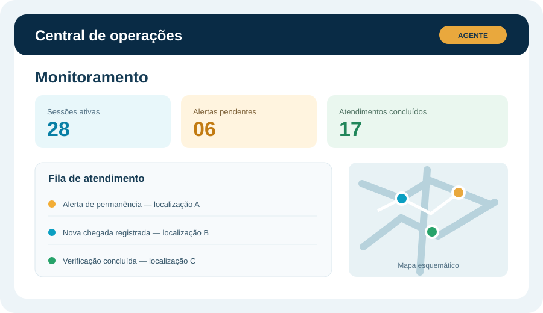
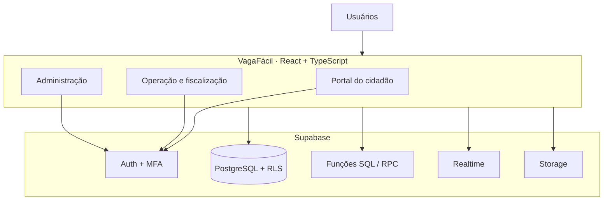

<div align="center">

# VagaFácil
### Estacionar ficou mais fácil.

**Plataforma municipal de estacionamento rotativo gratuito, com portal do cidadão, fiscalização e administração em uma única aplicação web.**

[](https://github.com/DevKove/VagaFacil/actions/workflows/validate.yml)


[🌐 Abrir aplicação](https://devkove.github.io/VagaFacil/) · [Código-fonte](https://github.com/DevKove/VagaFacil) · [Acompanhar validações](https://github.com/DevKove/VagaFacil/actions)

</div>

---

## Apresentação

O **VagaFácil** é uma solução digital para apoiar a operação do estacionamento rotativo municipal gratuito. Reúne os fluxos do motorista, o acompanhamento de ocorrências pelos agentes e as ferramentas de gestão da administração pública.

A interface é responsiva e foi projetada para uso em computadores e dispositivos móveis. A aplicação utiliza Supabase para autenticação, persistência e sincronização dos dados.

> **Sobre as imagens deste README:** a capa e os painéis apresentados abaixo são ilustrações vetoriais criadas para explicar visualmente os módulos. Não são capturas de tela, nem representam dados reais de produção. As telas reais podem ser adicionadas posteriormente em `docs/screenshots/`.

## Visão dos módulos

<div align="center">

### Portal do cidadão


*Representação conceitual do acompanhamento de uma sessão, identificação do veículo e localização do registro.*

### Operação e fiscalização


*Representação conceitual da fila de alertas, do acompanhamento operacional e das verificações em campo.*

### Administração


*Representação conceitual dos indicadores e das ferramentas de gestão, usuários, regras e relatórios.*

</div>

## Funcionalidades

### 🚗 Portal do cidadão
- Cadastro e autenticação por e-mail e senha.
- Recuperação e atualização de senha.
- Cadastro e gerenciamento dos veículos vinculados à conta.
- Registro de chegada com localização geográfica disponibilizada pelo dispositivo, mediante permissão do usuário.
- Acompanhamento de sessões e tempo de permanência.
- Consulta ao histórico e às notificações.
- Encerramento do registro pelo próprio usuário.
- Atualização de informações por Supabase Realtime, conforme os recursos habilitados.

### 🦺 Área do agente de trânsito
- Painel de acompanhamento das sessões e situações que exigem atenção.
- Consulta de registros e localização informada no momento da chegada.
- Visualização e atendimento de alertas.
- Registro do resultado da verificação em campo.
- Inclusão de observações e evidências, conforme permissões e configuração do sistema.
- Histórico de atendimentos e fiscalizações.

### 🏛️ Administração
- Painel de indicadores operacionais.
- Cadastro, edição e exclusão de usuários.
- Gestão de perfis, autorizações e acesso aos ambientes.
- Consulta de registros, sessões e alertas.
- Emissão administrativa de alertas quando necessário.
- Configuração dos parâmetros operacionais.
- Consulta e exportação de relatórios disponíveis.
- Recursos de auditoria, conforme estrutura e políticas configuradas no banco.

A disponibilidade de cada ação depende do perfil autenticado, das permissões concedidas e das políticas de segurança do Supabase.

## Fluxo simplificado

1. O cidadão acessa o portal e autoriza o uso da localização do dispositivo.
2. Registra a chegada e informa ou seleciona o veículo.
3. O sistema armazena o registro e apresenta o acompanhamento da permanência.
4. O agente consulta os registros e trata alertas ou situações que exigem verificação.
5. A administração acompanha a operação, gerencia acessos e consulta os dados disponíveis.

**Localização:** a precisão depende do dispositivo, do navegador, da disponibilidade dos serviços de localização e da autorização concedida pelo usuário. O sistema deve informar quando a posição não puder ser obtida; não se deve presumir uma coordenada precisa.

## Regras e responsabilidade operacional

Os parâmetros de utilização devem ser definidos e homologados pelo município responsável. Horários, limites de permanência, tolerâncias, feriados, categorias especiais e demais regras precisam refletir a legislação e a regulamentação local.

O registro de chegada, o vencimento de uma sessão ou a emissão de um alerta **não constituem, isoladamente, autuação ou aplicação automática de penalidade**. A fiscalização deve observar a legislação vigente e os procedimentos administrativos do município.

## Segurança e privacidade

- Autenticação gerenciada pelo Supabase Auth.
- Controle de acesso por perfil e permissões.
- Verificação de autorização para acesso às áreas operacionais e administrativas.
- Autenticação multifator TOTP nos fluxos operacionais/administrativos configurados.
- Políticas Row Level Security (RLS) nas tabelas expostas.
- Operações sensíveis executadas no backend, por funções SQL/RPC quando aplicável.
- Armazenamento de evidências com políticas de acesso apropriadas.
- Credenciais administrativas e segredos mantidos fora do frontend.

**Nunca** publique chaves `service_role`, tokens privados, senhas ou arquivos `.env`. A chave publicável do Supabase pode ser utilizada no cliente desde que as políticas RLS estejam corretamente configuradas.

## Tecnologias

| Tecnologia | Finalidade |
|---|---|
| React 19 | Interface e componentes |
| TypeScript 5 | Tipagem estática |
| Vite 6 | Desenvolvimento e build |
| Supabase Auth | Autenticação e MFA |
| Supabase PostgreSQL | Persistência e regras de acesso |
| Supabase Realtime | Atualização de dados em tempo real |
| Supabase Storage | Armazenamento de arquivos e evidências |
| Lucide React | Ícones |
| PWA / Service Worker | Recursos de instalação e cache |
| GitHub Actions | Validação e publicação |

## Arquitetura



## Estrutura do projeto

```text
VagaFacil/
├── .github/workflows/
│   ├── validate.yml
│   └── deploy.yml
├── docs/
│   └── illustrations/
│       ├── portal-cidadao.svg
│       ├── operacoes.svg
│       └── administracao.svg
├── public/
│   ├── IMG/
│   ├── favicon.svg
│   ├── manifest.webmanifest
│   ├── readme-cover.svg
│   └── sw.js
├── src/
│   ├── features/
│   │   ├── citizen/
│   │   └── operations/
│   ├── lib/
│   ├── App.tsx
│   ├── main.tsx
│   └── styles.css
├── supabase/
│   └── migrations/
├── .env.example
├── package.json
└── vite.config.ts
```

## Executar localmente

### Requisitos
- Node.js 22 ou superior.
- npm.
- Projeto Supabase configurado.

### 1. Clonar e instalar

```bash
git clone https://github.com/DevKove/VagaFacil.git
cd VagaFacil
npm install
```

### 2. Configurar o ambiente

Linux/macOS:

```bash
cp .env.example .env.local
```

Windows PowerShell:

```powershell
Copy-Item .env.example .env.local
```

Edite `.env.local` com os dados do seu projeto:

```env
VITE_SUPABASE_URL=https://SEU_PROJETO.supabase.co
VITE_SUPABASE_PUBLISHABLE_KEY=SUA_CHAVE_PUBLICA
```

Use a chave publicável (ou `anon` em projetos legados). Nunca utilize `service_role` em variáveis `VITE_*`.

### 3. Iniciar a aplicação

```bash
npm run dev
```

### 4. Validar e gerar a versão de produção

```bash
npm run lint
npm run build
npm run preview
```

## Banco de dados

As migrations versionadas estão em `supabase/migrations/`. Aplique-as em ordem cronológica no projeto de destino, revisando cada arquivo antes da execução.

Recomendações:
1. Faça backup antes de alterar um banco já utilizado.
2. Aplique primeiro em ambiente de desenvolvimento ou homologação.
3. Configure URLs de redirecionamento, confirmação de e-mail e autenticação no Supabase.
4. Revise políticas RLS, funções SQL, buckets e políticas de Storage.
5. Teste cada perfil com contas distintas antes de liberar o ambiente.

Não aplique migrations fora de ordem nem presuma que a criação de uma conta no Auth concede permissões administrativas.

## Publicação

A aplicação está configurada para publicação no GitHub Pages:

**https://devkove.github.io/VagaFacil/**

O caminho-base do Vite é `/VagaFacil/`. Os workflows do GitHub Actions executam validações e publicação conforme os eventos configurados no repositório.

- [Validar projeto](https://github.com/DevKove/VagaFacil/actions/workflows/validate.yml)
- [Publicar no GitHub Pages](https://github.com/DevKove/VagaFacil/actions/workflows/deploy.yml)
- [Histórico completo de execuções](https://github.com/DevKove/VagaFacil/actions)

A aprovação de build e lint confirma a integridade estática da compilação, mas não substitui testes de integração, testes de autorização/RLS, testes em dispositivos reais ou homologação municipal.

## PWA e uso offline

O projeto inclui manifesto e Service Worker. Isso permite oferecer recursos de instalação e cache, mas não significa que todos os fluxos funcionem sem conexão. Autenticação, gravação, sincronização e operações dependentes do Supabase exigem conectividade.

## Estado e homologação

O repositório reúne os módulos de cidadão, operação e administração e integrações com Supabase. O nível de disponibilidade de cada funcionalidade depende da versão publicada, da configuração do backend e das permissões do ambiente.

Antes do uso oficial, recomenda-se concluir:
- Testes E2E das jornadas de cidadão, agente e administrador.
- Auditoria das políticas RLS e das funções SQL/RPC.
- Testes de geolocalização em diferentes navegadores e dispositivos.
- Homologação das regras municipais e dos procedimentos de fiscalização.
- Testes de segurança, carga, backup e recuperação.
- Verificação de acessibilidade e experiência mobile.

**Não utilize o sistema como única fonte para autuação, cobrança ou decisão administrativa até que a implantação esteja formalmente homologada pelo município.**

## Contribuição

1. Crie uma branch para sua alteração.
2. Mantenha tipagem estrita e componentes coesos.
3. Não envie credenciais, dados pessoais ou arquivos de ambiente.
4. Execute `npm run lint` e `npm run build`.
5. Documente no Pull Request o objetivo, as alterações e os testes realizados.

## Licença

O repositório ainda não apresenta uma licença de distribuição. Até que uma licença seja publicada, não presuma autorização para redistribuir ou utilizar o código além das permissões aplicáveis.

---

<div align="center">

**VagaFácil** · Tecnologia a serviço da mobilidade urbana.

Mobilidade mais simples. Fiscalização mais organizada. Gestão mais transparente.

</div>
